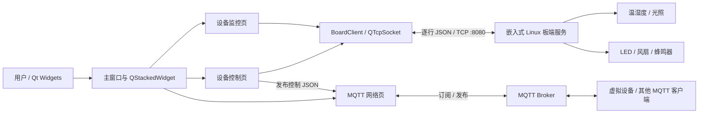

<div align="center">

# 基于 Qt + TCP/MQTT 的智能家居设备监控上位机


面向智能家居设备监控场景的 Qt Widgets 桌面上位机，通过 TCP/JSON 联动嵌入式硬件，并通过 MQTT 完成虚拟设备消息收发。

</div>

## 项目概览

项目由 Qt 上位机和嵌入式 Linux 板端 TCP 服务组成。上位机提供登录注册、状态总览、传感器监控、网络配置、设备控制和主题设置页面；板端服务读取温湿度、光照等设备节点，并控制 LED、风扇和蜂鸣器。

### 功能亮点

- 使用 Qt Widgets 与 `QStackedWidget` 组织多页面桌面界面，页面职责清晰。
- 封装 `BoardClient`，以 `QTcpSocket` 完成板端连接、断线通知、错误上报和逐行 JSON 收发。
- 使用 `QJsonDocument` / `QJsonObject` 构造控制指令并解析传感器状态。
- 使用 Qt MQTT 模块的 `QMqttClient` 完成 Broker 连接、Topic 订阅、消息发布和消息接收。
- 将板端连接状态、MQTT 连接状态和设备状态通过 Qt 信号槽同步到总览页面。
- 在监控、控制和网络页面显示带时间戳的操作日志，便于联调定位。
- 连接参数从本机 `config/app.ini` 读取，仓库只提供无凭据的示例配置。

## 系统架构



## Qt Widgets 页面与模块

| 页面或模块 | 主要职责 |
| --- | --- |
| 登录 / 注册 | 本地账号注册与登录校验；运行数据写入可执行程序旁的 `data/users.txt` |
| 主窗口 `Form` | 创建页面、管理导航、转发状态、应用主题并启动板端连接 |
| 首页 `HomeWidget` | 汇总 MQTT、板端连接及 LED、风扇、蜂鸣器状态 |
| 监控页 `MonitorWidget` | 展示温度、湿度、光照、执行器状态、更新时间与原始 JSON |
| 网络页 `NetworkWidget` | 配置 MQTT Broker、账号、Topic，连接、订阅、发布并查看消息 |
| 控制页 `DeviceWidget` | 生成板端或虚拟设备控制 JSON，并通过 TCP/MQTT 分流发送 |
| 设置页 `SettingsWidget` | 切换界面主题与背景色 |
| `BoardClient` | 管理 TCP 生命周期、缓冲区分帧、JSON 指令发送与数据上报 |

> 当前本地账号文件采用明文保存，仅用于课程演示，不适合生产环境。后续应改为带盐密码哈希和安全存储。

## TCP Socket 与硬件端 JSON 通信

板端在 `8080` 端口监听连接，上位机以换行符作为消息边界。`BoardClient` 将接收数据追加到缓冲区，按 `\n` 拆分完整 JSON，避免一次 `readyRead` 中出现半包或多包时直接误解析。

读取传感器数据：

```json
{"cmd":"read"}
```

板端状态响应：

```json
{
  "temperature": 26.5,
  "humidity": 61.2,
  "light": 386,
  "led": true,
  "fan": false,
  "beeper": false
}
```

设备控制与确认：

```json
{"cmd":"control","device":"fan","value":1}
```

```json
{"type":"reply","ok":true,"device":"fan","value":1}
```

板端当前通过字符串匹配识别控制字段，适合演示协议；更严格的实现应引入 JSON 解析库、字段校验和消息长度限制。

## MQTT 连接与状态同步

`NetworkWidget` 根据界面或本地配置设置 Host、Port、Client ID、用户名和密码，随后调用 `QMqttClient::connectToHost()`。连接成功后可订阅状态 Topic，并向控制 Topic 发布 JSON；收到的 Topic 与消息正文会显示在接收区，同时通过 `mqttMessageReceived` 信号向外暴露。

虚拟设备控制示例：

```json
{"id":0,"lamp":true}
```

目前已实现 MQTT 连接状态同步到首页；入站消息已完成接收、展示和信号转发，但尚未将不同 Topic 的设备状态 JSON 自动映射回控制页控件，这是后续状态闭环的重点。

## 项目目录

```text
.
├─ config/
│  └─ app.ini.example                    # 无敏感信息的连接配置模板
├─ 项目源码/
│  ├─ SmartHomeQt_linux/SmartHomeQt/     # Qt Widgets 上位机源码与 .pro 工程
│  └─ b_server/board/                    # 嵌入式 Linux 板端 TCP 服务与外设封装
├─ .gitignore
└─ README.md
```

课程报告、答辩材料、演示视频、压缩包、实验室仿真程序和编译产物不属于本仓库发布内容，已排除。

## 开发环境与依赖

- Qt 5.12.12（现有构建目录名称表明项目曾使用该版本）
- Qt Widgets、Qt Network、Qt MQTT 模块
- 支持 C++11 的编译器
- qmake 与 GNU Make（Linux）或 Qt Creator
- 板端：嵌入式 Linux、POSIX Socket，以及项目硬件封装所依赖的 sysfs / input / SPI 设备节点

## 配置

如果使用源码目录内构建，复制示例文件到可执行程序旁的 `config` 目录，并填写你自己的地址和凭据：

```powershell
New-Item -ItemType Directory -Force 项目源码/SmartHomeQt_linux/SmartHomeQt/config
Copy-Item config/app.ini.example 项目源码/SmartHomeQt_linux/SmartHomeQt/config/app.ini
```

应用从“可执行文件所在目录”的 `config/app.ini` 读取配置。Qt Creator 使用影子构建时，请改为把 `config/app.ini` 复制到影子构建生成的可执行文件旁。真实 MQTT 用户名、密码和个人局域网 IP 只应保存在 `app.ini`；该文件已被 Git 忽略。

## 构建与运行

### Qt 上位机

使用 Qt Creator 打开：

```text
项目源码/SmartHomeQt_linux/SmartHomeQt/SmartHomeQt.pro
```

或在已配置 Qt 5.12.12 与 Qt MQTT 模块的 Linux 终端中执行：

```bash
cd 项目源码/SmartHomeQt_linux/SmartHomeQt
qmake SmartHomeQt.pro
make -j$(nproc)
./SmartHomeQt
```

### 板端服务

板端源码直接访问硬件设备节点，应在匹配的嵌入式 Linux 开发板或对应交叉编译环境中构建：

```bash
cd 项目源码/b_server/board
qmake board.pro
make -j$(nproc)
./board
```

启动板端服务后，在 `app.ini` 中填写板端 IP；MQTT 功能还需要可访问的 Broker、正确 Topic，以及已安装的 Qt MQTT 模块。

## 异常处理与日志

- TCP：监听连接成功、断开和 `QAbstractSocket` 错误；未连接时拒绝发送并输出原因。
- 数据：缓存并按行拆包；JSON 解析失败时保留原始消息和更新时间，避免界面崩溃。
- MQTT：检查 Host、Port、Topic 和消息内容；订阅或发布失败时写入网络页日志。
- 用户数据：检查空账号、重复账号、非法分隔符和数据目录创建失败。
- 日志：界面日志带 `hh:mm:ss` 时间戳，板端使用标准输出；当前尚未实现日志文件轮转与分级。

## 当前完成度

已完成 Qt 多页面界面、本地登录注册、TCP 连接与 JSON 双向通信、板端传感器读取与执行器控制、MQTT 连接/订阅/发布、连接状态同步和主题切换。

后续计划：

- 将 MQTT 入站状态按 Topic 与设备 ID 解析并回写首页、监控页和控制页。
- 为 TCP 增加重连、心跳、超时、消息长度限制和严格 JSON 校验。
- 使用密码哈希替代明文本地账号文件，并增加配置文件权限保护。
- 抽象硬件接口，加入可在普通 PC 上运行的板端模拟器与自动化测试。
- 增加日志分级、文件轮转以及关键通信链路的单元/集成测试。
- 补充真实运行截图、硬件接线图、Broker Topic 约定和实机演示说明。

## 联系方式

邮箱：[1156852317@qq.com](mailto:1156852317@qq.com)
